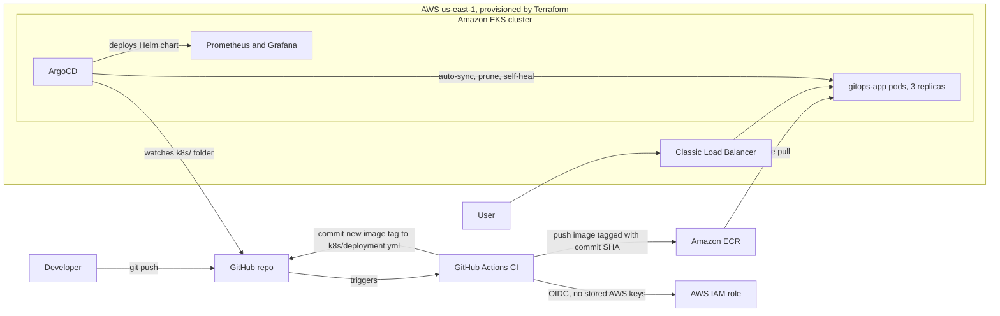
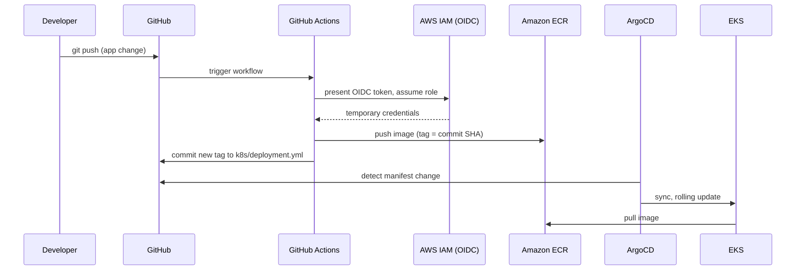

# GitOps on Amazon EKS: end-to-end delivery pipeline


A small Flask app delivered to **Amazon EKS** through a fully automated GitOps pipeline.
You push code to Git and everything else happens on its own: GitHub Actions builds the image and pushes it to Amazon ECR, a bot commits the new image tag, and ArgoCD syncs the cluster to match Git.
The infrastructure is provisioned with **Terraform**, and Prometheus and Grafana are deployed through ArgoCD as well.

Built by **Shipra** ([Cloud With Shipra](https://www.youtube.com/@CloudWithShipra)).

> The cluster is destroyed after every working session to control cost, so there is no permanent live URL. The screenshots and recordings below show each stage.

<!-- MEDIA: hero GIF. Screen recording of the page changing after a git push (docs/images/demo-auto-deploy.gif). Delete this block if you do not have the GIF. -->


**Video walkthrough (4 min):** TODO add YouTube link


## Contents

- [What this project demonstrates](#what-this-project-demonstrates)
- [Architecture](#architecture)
- [How the pipeline works](#how-the-pipeline-works)
- [Demos](#demos)
- [Tech stack](#tech-stack)
- [Repository layout](#repository-layout)
- [Design decisions](#design-decisions)
- [Security](#security)
- [Run it yourself](#run-it-yourself)
- [Teardown (the order matters)](#teardown-the-order-matters)
- [Cost](#cost)
- [Lessons learned](#lessons-learned)
- [Known limitations and next steps](#known-limitations-and-next-steps)

---

## What this project demonstrates

- **Infrastructure as Code.** A VPC (2 AZs, public and private subnets, NAT) and an EKS cluster created with Terraform: 58 resources, created in about 15 to 20 minutes and destroyed on demand.
- **CI with GitHub Actions.** Every push builds a Docker image and publishes it to ECR, tagged with the commit SHA.
- **Keyless AWS access from CI.** GitHub OIDC with an IAM role limited to one repository, one branch and one ECR repository. No AWS keys are stored in GitHub.
- **GitOps delivery.** ArgoCD with auto-sync, prune and self-heal. Git is the source of truth, and CI writes the new image tag back into Git.
- **Observability.** Prometheus and Grafana deployed by ArgoCD, with the dashboard stored in Git as JSON.
- **Failure testing.** A deleted pod and manual cluster drift both recovered without human action.

---

## Architecture



### Network (Terraform)

- 1 VPC across 2 Availability Zones
- 2 public subnets (load balancer, NAT) and 2 private subnets (worker nodes)
- 1 Internet Gateway and 1 NAT Gateway (a single NAT, to keep cost low while learning)
- EKS managed node group with 2 x `t3.medium` nodes in the private subnets, Kubernetes 1.36


---

## How the pipeline works



1. **Push** to `main`.
2. **GitHub Actions** builds the Docker image, assumes an AWS IAM role through OIDC, and pushes the image to ECR. The tag is the full commit SHA, so every image maps to exactly one commit.
3. A final CI step **updates the image tag** in `k8s/deployment.yml` and commits it as `github-actions[bot]`.
4. **ArgoCD** notices the Git change and syncs the cluster. Kubernetes does a rolling update, and the readiness probe keeps traffic away from pods that are not ready yet.

**Preventing a CI loop.** The workflow ignores changes under `k8s/`, `argocd/`, `terraform/` and `*.md` (`paths-ignore`), the bot commit carries `[skip ci]`, and commits made with the default `GITHUB_TOKEN` do not trigger new workflow runs.


---

## Demos

### 1. Change a config value in Git, and the cluster follows

Changing `APP_VERSION` from `v3` to `v4` in `k8s/deployment.yml` and pushing was enough. ArgoCD rolled out new pods, and the badge and page colour changed without any `kubectl` command. For a short while the page answers from both old and new pods, which is what a rolling update looks like from the outside.

<!-- MEDIA: docs/images/demo-config-change.gif, browser window only. Delete the next line if you do not have it. -->


### 2. Change code, and the whole pipeline runs by itself

Editing the page footer in `app/app.py` and pushing triggered CI, the ECR push, the bot commit, the ArgoCD sync and a rolling update, with no manual step.

<!-- MEDIA: docs/images/demo-auto-deploy.gif is already used at the top. Reuse the screenshots above here. -->

### 3. Chaos tests

| Test | What I did | What happened |
|------|-----------|---------------|
| Pod deletion | Deleted one pod while polling the load balancer in a loop | Kubernetes created a replacement. No failed request in my test (no `000` responses). |
| Manual drift | `kubectl scale deployment gitops-app --replicas=1` | ArgoCD self-heal restored 3 replicas in about 1 to 2 minutes, because Git says 3. |


<!-- MEDIA: docs/images/demo-chaos.gif, optional. Delete the next line if you do not have it. -->


---

## Tech stack

| Area | Tools |
|------|-------|
| App | Python, Flask, Gunicorn |
| Containers | Docker (non-root user), Amazon ECR with scan on push |
| CI | GitHub Actions |
| CD and GitOps | ArgoCD (auto-sync, prune, self-heal) |
| Infrastructure as Code | Terraform (community VPC and EKS modules) |
| Orchestration | Amazon EKS (Kubernetes 1.36) |
| Monitoring | Prometheus and Grafana (kube-prometheus-stack, deployed by ArgoCD) |
| Auth from CI to AWS | GitHub OIDC with an IAM role, no long-lived access keys |

---

## Repository layout

```
.
├── app/                    Flask app, Dockerfile, requirements
├── k8s/                    Deployment and Service (ArgoCD watches this folder)
├── argocd/                 ArgoCD Application manifests (app and monitoring)
├── terraform/              VPC and EKS
├── monitoring/             Grafana dashboard JSON
├── docs/                   Runbook, troubleshooting guide, images
└── .github/workflows/      CI pipeline
```


---

## Design decisions

| Decision | Why |
|----------|-----|
| Image tag is the commit SHA, never `latest` | Every running pod can be traced to one commit, and a rollback is a Git revert. |
| CI writes the tag back to Git instead of calling the cluster | The cluster never needs credentials that CI holds. Git stays the single source of truth. |
| ArgoCD `selfHeal` and `prune` on | Manual changes in the cluster are reverted, and files removed from Git are removed from the cluster. |
| Worker nodes in private subnets | Nodes are not reachable from the internet. Only the load balancer is public. |
| GitHub OIDC instead of access keys | Nothing long-lived to leak, and the trust policy limits access to this repo and branch. |
| Prometheus and Grafana deployed by ArgoCD | Monitoring is declared in Git like the app, and ArgoCD would restore it if it drifted. |
| Single NAT Gateway | Saves cost while learning. The trade-off is listed under limitations. |

---

## Security

- **No AWS keys in GitHub.** CI uses GitHub OIDC, and the IAM role trust policy only allows this repository's `main` branch.
- **Least privilege for CI.** The role can only push images to one ECR repository.
- **Container runs as a non-root user**, and ECR scans every pushed image.
- **Secrets stay out of Git.** `.gitignore` covers Terraform state and variable files, `.env` files and keys. I also searched the repository and its history for state files, keys and AWS access key patterns before publishing.

<!-- MEDIA: optional, docs/images/13-iam-trust-policy.png with the AWS account ID blacked out. Delete the next line if you do not add it. -->


ECR basic scan results on an early image: no critical findings, and a few high and medium findings. The scan does not block the pipeline yet (a severity gate is on the roadmap).


---

## Run it yourself

Prerequisites: an AWS account, Terraform, AWS CLI, kubectl, Docker and Git.

```bash
# 1. One-time bootstrap (done manually in this project):
#    ECR repository "gitops-app", GitHub OIDC provider, and an IAM role for CI.
#    Details are in docs/RUNBOOK.md

# 2. Create the infrastructure (about 15 to 20 minutes)
cd terraform
terraform init
terraform apply

# 3. Connect kubectl
aws eks update-kubeconfig --region us-east-1 --name Gitops-eks

# 4. Install ArgoCD
kubectl create namespace argocd
kubectl apply -n argocd --server-side --force-conflicts \
  -f https://raw.githubusercontent.com/argoproj/argo-cd/stable/manifests/install.yaml

# 5. Hand control to GitOps
kubectl apply -f argocd/application.yml
kubectl apply -f argocd/monitoring.yml
```

Open Grafana without a load balancer, then import `monitoring/gitops-app-health.json`:

```bash
kubectl port-forward svc/kube-prometheus-stack-grafana -n monitoring 3000:80
```

The full step-by-step guide, including the one-time AWS setup, is in [docs/RUNBOOK.md](docs/RUNBOOK.md).

---

## Teardown (the order matters)

The AWS load balancer is created by **Kubernetes**, not by Terraform. If the cluster is deleted first, the load balancer and its security group stay behind and the VPC cannot be deleted.

```bash
# 1. Stop ArgoCD from recreating things
kubectl delete application gitops-app -n argocd

# 2. Remove the LoadBalancer Service (this deletes the AWS load balancer and its security group)
kubectl delete svc gitops-app

# 3. Verify nothing is left in AWS
aws elb describe-load-balancers --query 'LoadBalancerDescriptions[].LoadBalancerName'
aws elbv2 describe-load-balancers --query 'LoadBalancers[].LoadBalancerName'

# 4. Only now destroy the infrastructure
cd terraform && terraform destroy
```


Because everything is code, the whole environment can be rebuilt with one `terraform apply`.

---

## Cost

While running, the cluster costs roughly **$0.23 to $0.25 per hour** (EKS control plane, 2 nodes, NAT Gateway, plus a small amount for the load balancer). These are approximate figures, so check current AWS pricing.
I created the environment for each work session and destroyed it afterwards.

Actual cost of the build and demo session: TODO fill in from AWS Billing

---

## Lessons learned

The full list with commands is in [docs/TROUBLESHOOTING.md](docs/TROUBLESHOOTING.md). The ones that taught me the most:

- **OIDC trust policy.** The `sub` claim in the GitHub token for this repo included numeric account and repository IDs, so my first trust policy (plain `repo:owner/name:ref:...`) did not match, and AWS answered with a generic `Not authorized to perform sts:AssumeRoleWithWebIdentity`. I found the real value by decoding the token claims in a temporary debug workflow (printing only the claims, never the token).
- **Broken YAML never reached the cluster.** I pushed a malformed `deployment.yml`. ArgoCD refused to apply it and kept the last good state, and fixing the file in Git recovered everything.
- **Teardown order.** Resources created by Kubernetes (load balancer, security group) are not in Terraform state. Not removing them first left the VPC stuck on destroy.
- **Versions that cost money.** Kubernetes versions outside standard support are billed at a higher control plane rate, so I checked supported versions with the AWS CLI instead of trusting a docs page.
- **Bot commits change how you use Git.** CI now commits to `main`, so I run `git pull` before every push.

---

## Known limitations and next steps

- Tasks in the API (`/api/tasks`) are stored in memory per pod, so they are not shared between replicas and are lost on restart. A database is the next step.
- The API has no authentication and the app is served over plain HTTP. Production would need HTTPS (ACM and an ALB ingress) and authentication.
- One NAT Gateway serves both AZs. Production would use one per AZ.
- Deleting all three pods at the same time causes a short outage. PodDisruptionBudgets and topology spread constraints would help.
- Prometheus and Grafana run without persistent storage (the EBS CSI driver is not installed), so metrics reset with the cluster.
- CI only builds and pushes. Adding YAML validation, Trivy scanning with a severity gate, and unit tests is planned.
- The ECR repository and the OIDC role were created by hand, and Terraform state is local. Moving them into Terraform with remote state in S3 would make the setup fully reproducible.
- The IAM user that runs Terraform has broad permissions for convenience while learning. A production setup would use a scoped role.
- The bot commits straight to `main`, and there is no staging environment or approval step before production.
